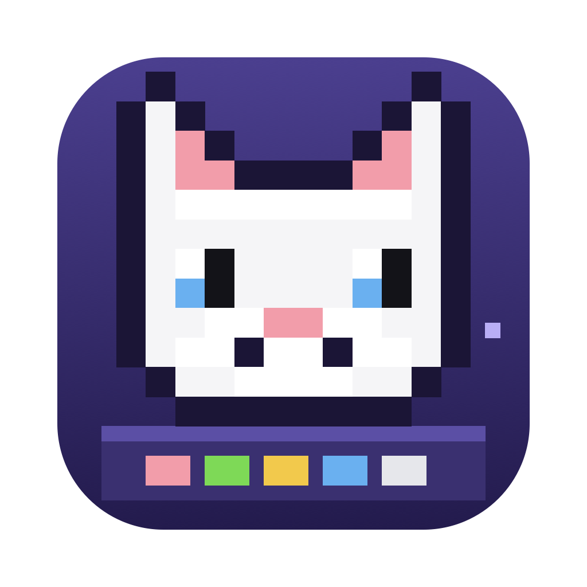

<p align="center"></p>

# Dockat

Gatinhos pixel art que vivem no seu Dock do macOS. Eles andam, sentam, dormem, se espreguiçam, levam bronca e brigam entre si. Escolha a pelagem, a personalidade e quantos gatos quiser. O app fica na barra de menus ().

## Baixar

1. Baixe o **Dockat.zip** na [última versão](../../releases/latest) e descompacte.
2. Arraste o **Dockat.app** para a pasta Aplicativos.
3. Na primeira vez, clique com o botão direito no app e escolha **Abrir** (o app não é notarizado pela Apple). Se o macOS reclamar, rode no Terminal:
   ```sh
   xattr -dr com.apple.quarantine /Applications/Dockat.app
   ```

Requer macOS 14 ou mais novo. Funciona em Apple Silicon e Intel.

## Usar

Clique no gatinho da barra de menus → **Gatos e ajustes…** para adicionar gatos, trocar a pelagem e a personalidade e ligar a abertura automática no login. Para os gatos acertarem a posição do Dock, escolha **Medir o Dock certinho (Acessibilidade)…** e dê a permissão.

## Compilar

```sh
./build.sh            # gera o Dockat.app nesta pasta
./build.sh install    # também copia para /Applications e abre
./Tools/gerar-icone.sh  # regenera o logo e o Dockat.icns em Assets/
```

Precisa só das Command Line Tools (`swiftc`). Todo o desenho dos gatos está em `Sources/Sprites.swift`, em texto, uma letra por pixel.
